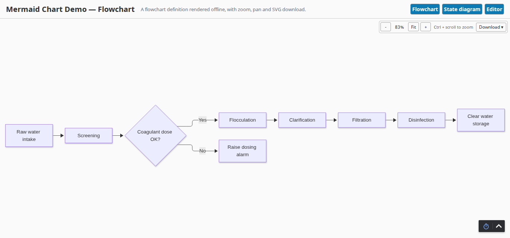
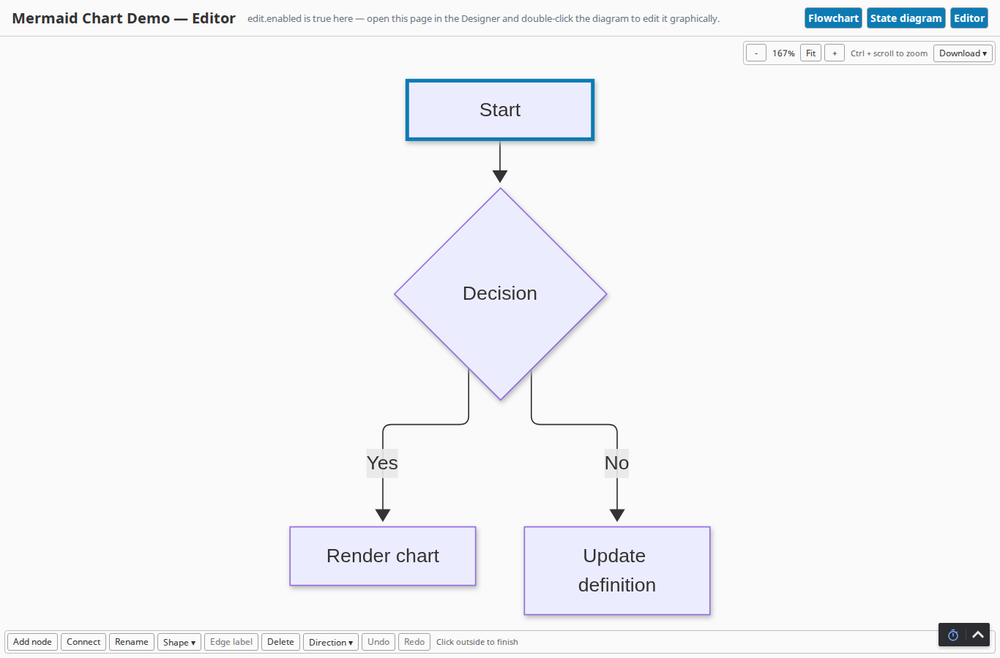

# Mermaid Chart

An Ignition 8.3 Perspective component that draws a [Mermaid](https://mermaid.js.org) diagram from a text definition, with zoom, pan and SVG download, and no network access.

> **Not an Inductive Automation product, and not supported by Inductive Automation.** Independent work, largely built with AI tools and tested for one purpose on a limited subset of gateway versions and platforms. Take the ideas; fork and review it before it goes near production. Feedback is welcome in Issues; improvements are made where possible, but no support is guaranteed. [NOTICE.md](NOTICE.md) says more.

This is a fork of Cognidata Mermaid Chart 1.0.0 (MIT, <https://cognidata.org>), rebuilt for Ignition 8.3. It is not affiliated with or supported by Cognidata. The property names are unchanged, so [Cognidata's documentation](https://github.com/smallcuber/cognidata-mermaid-docs) for properties and interaction still applies.

## Why this exists

Flowcharts, state machines, entity diagrams and sequence diagrams are easier to keep as text than as drawn shapes: a definition can come from a tag, a query or a script and redraw when it changes. Cognidata's module was built for 8.1, and 8.3 refuses to load it (`requires Ignition 8.1.8 and is not compatible with Ignition 8.3.x`, status FAULTED). This fork runs on 8.3 and bundles every diagram type, so it works on a gateway with no internet access.

## What it looks like


*The component rendering a flowchart, with zoom/pan controls and the Download menu above it.*


*Mid-edit: the diagram is deep-selected, the Start node has a selection outline, and the
editor toolbar (Add node, Connect, Rename, Shape, Edge label, Delete, Direction, Undo,
Redo) sits below it.*

## What it does

| Feature | Detail |
| --- | --- |
| Diagram types | Everything Mermaid supports: flowchart, sequence, class, state, entity-relationship, Gantt, pie, mindmap, timeline, git graph, Sankey, XY chart and the rest |
| Offline | Mermaid and each diagram type are served from the gateway, loaded on first use; no CDN, no external fonts |
| Fit | `fitMode` fits the diagram to the component by `contain`, `width`, `height` or `none`, inside `padding` |
| Zoom and pan | Buttons (−, Fit, +), mouse wheel (Ctrl or Cmd + wheel by default), and drag to pan; limits and step in `zoom.*` |
| Two-way zoom | `zoomLevel` reports the current zoom and can be written to set it |
| Download | Saves the rendered diagram as an SVG file |
| Themes | Mermaid's `default`, `base`, `dark`, `forest` and `neutral` |
| Safety | `securityLevel` defaults to `strict`; an unrecognised value falls back to `strict` |
| Errors | A parse error is shown in the component (turn off with `showError`) instead of a blank box |
| Graphical editing | Flowcharts can be edited on the Designer canvas: add, connect, rename, reshape and delete nodes, label edges, change direction, with undo |

The demo project's screens meet WCAG 2.1 AA except for limits in Perspective itself: no page language setting, and the diagram's own internal SVG structure (its nodes, edges and labels) beyond the accessible name the component gives the diagram as a whole.

## How to use it

1. Install `MermaidChart-0.3.2.modl` from **Platform > Modules > Install or Upgrade Module**, and accept its certificate and licence. Uninstall Cognidata's Mermaid Chart first if it is present.
2. In the Designer, open a Perspective view and drag **Mermaid Chart** from the component palette (category *Mermaid Chart*).
3. Set `props.definition`, for example:

   ```text
   flowchart LR
       Intake[Raw water intake] --> Screen[Screening]
       Screen --> Coag{Coagulant dose OK?}
       Coag -->|Yes| Floc[Flocculation]
       Coag -->|No| Alarm[Raise dosing alarm]
   ```

4. Bind `definition` to a tag, a query or an expression to have the diagram redraw when the source changes.

## Editing a flowchart in the Designer

Set `edit.enabled` to `true`, then **double-click** the diagram in design mode. A single click still selects the component and a drag still moves it; the double-click hands the mouse to the diagram, and a toolbar appears under it. Click outside the component to finish.

- Click a node to select it. Click an edge (or its label), or select a node and Shift-click a second one, to select the edge between them.
- **Add node** adds a node linked from the selected node, or an unlinked one if nothing is selected.
- **Connect** then click a target node to add an edge from the selected node.
- **Rename** and **Edge label** open a box over the node or edge: Enter commits, Escape cancels.
- **Shape**, **Delete**, and **Direction** (top to bottom, left to right, bottom to top, right to left).
- Every control works from the keyboard: Tab to it, Enter or Space to use it; in the Shape and Direction menus the arrow keys move, Enter picks and Escape closes.
- **Undo** and **Redo** step through this component's own edits (about 50). The Designer's Edit > Undo does not see them.

Each edit rewrites `props.definition`, which marks the view modified; save as usual. The editor never shows in a session or in Preview, whatever `edit.enabled` says. Other diagram types show "Graphical editing supports flowcharts; edit the definition text".

What round-trips: nodes, labels (including markdown), shapes, edges with their labels, arrow types and lengths, subgraphs, `classDef`, `class`, `style`, `linkStyle`, `click`, accessibility titles, front matter and `%%{init}%%` directives. What does not: `%%` comments are dropped, and the text is rewritten one statement per line (nodes first, then edges, so `A --> B --> C` becomes two lines, and `TD` becomes `TB`). Before the first edit of a definition that would change this way, the editor asks once. Flowcharts using icon or image nodes, `@{ }` options on subgraphs, or other syntax the model cannot carry are not editable graphically.

## Configuration reference

| Property | Type | Default | Meaning |
| --- | --- | --- | --- |
| `definition` | string | a sample flowchart | Mermaid source text |
| `theme` | string | `default` | Mermaid theme |
| `securityLevel` | string | `strict` | Mermaid security level; keep `strict` for definitions from untrusted sources |
| `showError` | boolean | `true` | Show parse and render errors in the component |
| `fitMode` | string | `contain` | `contain`, `width`, `height` or `none` |
| `padding` | number | `8` | Pixels kept clear around the fitted diagram |
| `zoom.enabled` | boolean | `true` | Allow zoom and pan |
| `zoom.showControls` | boolean | `true` | Show the zoom buttons |
| `zoom.wheel` | boolean | `true` | Allow wheel zoom |
| `zoom.wheelModifier` | boolean | `true` | Wheel zoom needs Ctrl or Cmd held; `false` zooms on a plain wheel |
| `zoom.initial` | number | `1` | Multiplier applied to the first fit |
| `zoom.min`, `zoom.max` | number | `0.25`, `4` | Zoom limits |
| `zoom.step` | number | `0.25` | Increment for buttons and wheel |
| `zoomLevel` | number | `1` | Current zoom; written by the component, and writable to set it |
| `download.enabled`, `download.showControls`, `download.svg` | boolean | `true` | Offer the Download menu and its SVG option |
| `edit.enabled` | boolean | `false` | Show the graphical editor in the Designer (double-click the diagram) |
| `style` | style | | Perspective style and classes |

Security levels `loose` and `antiscript` allow click handlers and HTML labels in the definition. Only use them when every definition comes from someone you trust.

## Building from source

Needs Java 17 and Node.js 22 or later.

```bash
./gradlew build          # bundles web-ui, builds the jars, signs and checks the .modl
./gradlew check          # also runs the web-ui unit tests
```

After a version bump, run `rm -rf build/moduleContent` before building: an incremental build keeps the old version's jars. Signing reads the keystore settings from an untracked `gradle.properties` (see `gradle.properties.template`); without it the build skips signing.

| Path | Holds |
| --- | --- |
| `common/` | Component descriptor and the property schema, shared by gateway and Designer |
| `gateway/` | Registers the component and serves the browser bundle at `/res/gaskony-mermaid/` |
| `designer/` | Puts the component in the Designer palette |
| `web-ui/` | The React component (TypeScript), bundled with webpack |

## Licence

MIT, as upstream is; see `LICENSE`. Bundled third-party libraries keep their own licences, listed in the module's `THIRD-PARTY-LICENSES.txt`.
